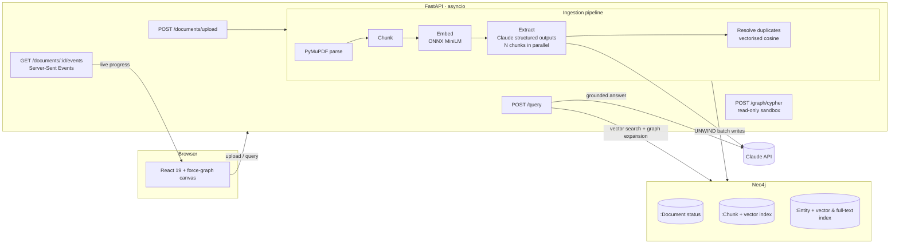

# Synapse

**From document to memory, instantly.** Synapse turns PDFs into an interactive knowledge graph you can explore, edit and question in plain English.

[](https://github.com/nicoleleehy1/Synapse/actions/workflows/ci.yml)

## Demo


## What it does

1. **Upload a PDF.** The ingestion pipeline parses it, splits it into overlapping passages, embeds them, and has Claude extract typed entities and relationships from every passage concurrently. Progress streams to the browser live, stage by stage.
2. **Explore the graph.** A force-directed canvas (or a sortable table) of everything the document talks about. Click to inspect, double-click to drill in, and add, rename, connect or delete nodes, with undo.
3. **Ask questions.** Hybrid retrieval combines vector search over passages with multi-hop graph expansion around the entities they mention, and Claude answers with numbered citations back to the source pages.

## Architecture



**Neo4j is the single source of truth.** Passages and entities carry their embeddings in Neo4j's native vector indexes, and ingestion jobs live on `(:Document)` nodes. The API process holds no state of its own, so it can be restarted, redeployed or scaled out without losing anything.

## Engineering highlights

| Area | What it does | Why |
|---|---|---|
| Extraction | Claude **structured outputs** validated against a Pydantic schema; chunks are processed concurrently behind a bounded semaphore; one failing chunk degrades gracefully instead of failing the document | No brittle JSON parsing, and wall-clock time drops roughly N-fold |
| Storage | Native Neo4j **vector indexes** for passages and entities, a full-text index on entity names, and `UNWIND` batch writes | One database for graph and vectors; a document is written in a handful of round trips |
| Live progress | Per-stage status persisted to Neo4j and fanned out over **Server-Sent Events**, with a polling fallback in the client | Real-time UX that survives proxies and reconnects |
| Retrieval | Vector top-k → entities mentioned in those passages → multi-hop neighbourhood expansion in a single Cypher query → grounded answer with citations | Answers draw on structure, not only on similar text |
| Entity resolution | Exact-key short-circuit plus vectorised cosine similarity per entity type, one embedding call per batch | Merges "Ada Lovelace" and "ada lovelace" without ever merging across types |
| Embeddings | `fastembed` (ONNX Runtime) running all-MiniLM-L6-v2 on CPU, baked into the image | Same model as sentence-transformers without PyTorch, so the image is roughly 10x smaller |
| Security | User Cypher runs in a **READ-mode transaction** (the database rejects every write) with a server-side timeout and row cap; uploads checked for size, page count and PDF magic bytes; per-IP rate limits on endpoints that spend tokens; no default credentials | Safe to put on the public internet |
| Testing | 26 pytest tests, including end-to-end upload → SSE → graph → query → delete against a **real Neo4j**, plus Vitest/Testing Library tests for the client; all run in GitHub Actions | Confidence that the whole system works, not just its units |

## Run it locally

You need Docker and an [Anthropic API key](https://console.anthropic.com/).

```bash
cp .env.example .env        # set ANTHROPIC_API_KEY and a NEO4J_PASSWORD
docker compose up --build
```

- App: http://localhost:5173
- API docs: http://localhost:8000/docs
- Neo4j Browser: http://localhost:7474

### Development without Docker (hot reload)

```bash
# Neo4j
docker run -d --name neo4j -p 7474:7474 -p 7687:7687 -e NEO4J_AUTH=neo4j/devpassword neo4j:5.26-community

# Backend
cd backend
uv venv && uv pip install -r requirements-dev.txt     # or: python -m venv .venv && pip install -r requirements-dev.txt
cp .env.example .env                                   # fill in ANTHROPIC_API_KEY, NEO4J_PASSWORD=devpassword
uv run uvicorn app.main:app --reload                   # http://localhost:8000/docs

# Frontend
cd frontend
npm install
npm run dev                                            # http://localhost:5173 (proxies /api to :8000)
```

### Tests

```bash
cd backend  && NEO4J_TEST_URI=bolt://localhost:7687 NEO4J_TEST_PASSWORD=devpassword uv run pytest
cd frontend && npm test && npm run lint && npm run typecheck
```

Integration tests are skipped when `NEO4J_TEST_URI` is unset. They use a fake Claude client and an offline embedder, so they need no API key or network access.

## Deploy

The repo ships a [Render Blueprint](render.yaml) that deploys the API (Docker) and the frontend (static site) together, with Neo4j on the free tier of AuraDB.

1. Create a free instance at [console.neo4j.io](https://console.neo4j.io) and save the connection URI and password.
2. In Render, choose **New → Blueprint** and point it at this repository.
3. When prompted, fill in `ANTHROPIC_API_KEY`, `NEO4J_URI` (the `neo4j+s://…` URI) and `NEO4J_PASSWORD`.

Render wires the two services to each other: the frontend gets the API's URL, and the API's CORS allow-list gets the frontend's URL. Any platform that runs a Docker image works the same way: set the environment variables in [`backend/.env.example`](backend/.env.example) and build the frontend with `VITE_API_URL` pointing at the API.

## Configuration

All backend settings are environment variables (see [`backend/app/config.py`](backend/app/config.py)).

| Variable | Default | Purpose |
|---|---|---|
| `ANTHROPIC_API_KEY` | (required) | Claude API key |
| `NEO4J_URI` / `NEO4J_USER` / `NEO4J_PASSWORD` | `bolt://localhost:7687` / `neo4j` / (required) | Database connection |
| `LLM_MODEL` | `claude-opus-5-5` | Model for extraction and answers |
| `EXTRACTION_EFFORT` / `ANSWER_EFFORT` | `low` / `medium` | Claude effort level per task |
| `EXTRACTION_CONCURRENCY` | `8` | Chunks extracted in parallel |
| `MAX_UPLOAD_MB` / `MAX_PAGES` | `25` / `150` | Upload limits |
| `UPLOADS_PER_HOUR` / `QUERIES_PER_HOUR` | `10` / `120` | Per-IP rate limits |
| `CORS_ORIGINS` | `http://localhost:5173` | Comma-separated allowed origins |
| `TRUST_PROXY_HEADERS` | `false` | Use `X-Forwarded-For` for client IPs behind a proxy |

## Project layout

```
backend/app/
  services/
    pdf_processor.py  PyMuPDF text extraction and cleanup
    chunker.py        Sentence-aware overlapping chunker
    embeddings.py     fastembed (ONNX) embedder, swappable via a protocol
    extractor.py      Claude structured-output entity/relationship extraction
    resolver.py       Vectorised entity de-duplication
    graph_store.py    Async Neo4j layer: schema, vector search, batch writes, read-only sandbox
    pipeline.py       Concurrent ingestion with persisted, streamed progress
    retriever.py      Hybrid vector + graph retrieval and grounded answers
    events.py         Pub/sub that feeds the SSE endpoint
  routers/            documents (upload, SSE, delete), graph (read, edit, Cypher), query
  ratelimit.py        Sliding-window limiter for endpoints that spend tokens
backend/tests/        Unit tests + end-to-end tests against real Neo4j
frontend/src/
  components/         GraphCanvas, TableView, FileUpload, QueryPanel, NodeInspector, modals
  hooks/              useDocumentUpload (SSE), useGraphData, useGraphEditor (undo)
```

## Roadmap

- **GraphRAG engine:** community detection with hierarchical summaries for corpus-level questions, a text-to-Cypher agent, streaming answers with citations highlighted on the graph, cross-document entity merging, and an evaluation harness.
- **Learning layer:** flashcards generated from graph edges and scheduled with FSRS spaced repetition, a mastery heatmap on the graph, and click-through to the highlighted passage in the source PDF.
