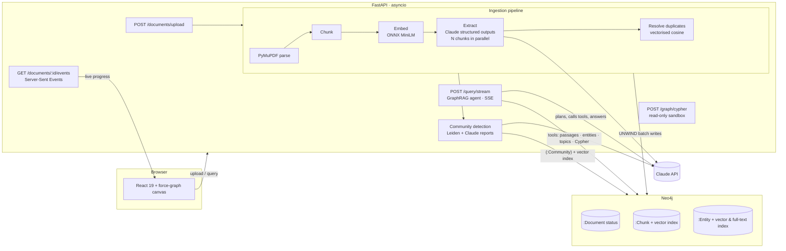

# Synapse

**From document to memory, instantly.** Synapse turns PDFs into an interactive knowledge graph you can explore, edit and question in plain English.

[](https://github.com/nicoleleehy1/Synapse/actions/workflows/ci.yml)

## Demo


## What it does

1. **Upload a PDF.** The ingestion pipeline parses it, splits it into overlapping passages, embeds them, and has Claude extract typed entities and relationships from every passage concurrently. Progress streams to the browser live, stage by stage.
2. **Explore the graph.** A force-directed canvas (or a sortable table) of everything the document talks about. Click to inspect, double-click to drill in, and add, rename, connect or delete nodes, with undo.
3. **Ask questions across every document.** A GraphRAG agent decides how to answer. It searches passages, looks up and walks entities, reads topic reports for "big picture" questions, or writes its own read-only Cypher. Its reasoning streams to the browser step by step, the answer cites source pages, and the nodes it used light up on the graph.
4. **Browse topics.** Leiden community detection groups the graph into a two-level hierarchy of topics, and Claude writes a report for each one. Click a topic to light up its members.
5. **One graph, many documents.** Entities from a new upload are merged with matching ones already in the graph, so an organisation named in three PDFs is one node with edges from all three.
6. **Learn it.** Claude turns relationships in the graph into flashcards grounded in their source passages. You review them on an FSRS spaced-repetition schedule, and a mastery heatmap on the graph shows what you know and what is fading.
7. **Check the source.** Every citation and flashcard opens the original PDF page with the exact passage highlighted.

## Architecture



**Neo4j is the single source of truth.** Passages and entities carry their embeddings in Neo4j's native vector indexes, and ingestion jobs live on `(:Document)` nodes. The API process holds no state of its own, so it can be restarted, redeployed or scaled out without losing anything.

## Engineering highlights

| Area | What it does | Why |
|---|---|---|
| Extraction | Claude **structured outputs** validated against a Pydantic schema; chunks are processed concurrently behind a bounded semaphore; one failing chunk degrades gracefully instead of failing the document | No brittle JSON parsing, and wall-clock time drops roughly N-fold |
| Storage | Native Neo4j **vector indexes** for passages and entities, a full-text index on entity names, and `UNWIND` batch writes | One database for graph and vectors; a document is written in a handful of round trips |
| Live progress | Per-stage status persisted to Neo4j and fanned out over **Server-Sent Events**, with a polling fallback in the client | Real-time UX that survives proxies and reconnects |
| GraphRAG agent | Claude runs a tool loop (strict tool schemas, prompt caching, a step budget that forces an answer) over five tools: passage vector search, hybrid entity search (full-text + vector fused with reciprocal rank fusion), multi-hop neighbourhood walks, topic-report search, and text-to-Cypher in the read-only sandbox. Steps, tool results and answer tokens stream over SSE | Picks the right retrieval per question instead of one fixed pipeline, and self-corrects when a Cypher query fails or returns nothing |
| Communities | Bottom-up hierarchical **Leiden**: fine communities, then Leiden again on the quotient graph to group them into broad topics. Community ids hash their member set, so a rebuild only re-summarises communities that changed; rebuilds are debounced in the background | Answers corpus-level questions ("what are the main themes?") that nearest-passage retrieval can't |
| Cross-document merge | New entities are matched against the existing graph through the entity vector index (same type, cosine above a threshold); entities and edges record which documents mention them, and deleting a document removes only what it contributed | One knowledge graph across uploads, with clean deletes |
| Spaced repetition | A from-scratch implementation of **FSRS-5**, the memory model Anki uses: per-card stability and difficulty, a power-law forgetting curve, and intervals solved for 90% target retention. Cards test single graph edges and link to the passage they came from. Mastery per entity is the mean recall probability of its cards *right now*, so the heatmap fades between reviews exactly as the model predicts | Turns a document graph into something you can actually learn, with scheduling backed by a published model instead of fixed intervals |
| Source highlighting | At ingest, each chunk is aligned against the PDF's word boxes on normalised tokens (start and end anchors), and the matched words are merged into one rectangle per line, stored as page fractions. The viewer renders the page with **pdf.js** (code-split, loaded on first use) and overlays the rectangles | Exact provenance for every answer and card, even though chunk text was cleaned and can't be found by substring search |
| Evaluation | `backend/eval/` ingests a fictional three-document corpus and grades the fixed pipeline against the agent on local, multi-hop, aggregation, global and unanswerable questions, using a blind Claude judge with key-fact recall | Measured, not asserted |
| Entity resolution | Exact-key short-circuit plus vectorised cosine similarity per entity type, one embedding call per batch | Merges "Ada Lovelace" and "ada lovelace" without ever merging across types |
| Embeddings | `fastembed` (ONNX Runtime) running all-MiniLM-L6-v2 on CPU, baked into the image | Same model as sentence-transformers without PyTorch, so the image is roughly 10x smaller |
| Security | User Cypher runs in a **READ-mode transaction** (the database rejects every write) with a server-side timeout and row cap; uploads checked for size, page count and PDF magic bytes; per-IP rate limits on endpoints that spend tokens; no default credentials | Safe to put on the public internet |
| Testing | 52 pytest tests, including end-to-end upload → SSE → graph → query → delete against a **real Neo4j**, plus Vitest tests for the client, the SSE parser and the agent state machine; all run in GitHub Actions | Confidence that the whole system works, not just its units |

## Run it locally

You need Docker and an [Anthropic API key](https://console.anthropic.com/).

```bash
cp .env.example .env        # set ANTHROPIC_API_KEY and a NEO4J_PASSWORD
docker compose up --build
```

- App: http://localhost:5173
- API docs: http://localhost:8000/docs
- Neo4j Browser: http://localhost:7474

### Development without Docker (hot reload)

```bash
# Neo4j
docker run -d --name neo4j -p 7474:7474 -p 7687:7687 -e NEO4J_AUTH=neo4j/devpassword neo4j:5.26-community

# Backend
cd backend
uv venv && uv pip install -r requirements-dev.txt     # or: python -m venv .venv && pip install -r requirements-dev.txt
cp .env.example .env                                   # fill in ANTHROPIC_API_KEY, NEO4J_PASSWORD=devpassword
uv run uvicorn app.main:app --reload                   # http://localhost:8000/docs

# Frontend
cd frontend
npm install
npm run dev                                            # http://localhost:5173 (proxies /api to :8000)
```

### Tests

```bash
cd backend  && NEO4J_TEST_URI=bolt://localhost:7687 NEO4J_TEST_PASSWORD=devpassword uv run pytest
cd frontend && npm test && npm run lint && npm run typecheck
```

Integration tests are skipped when `NEO4J_TEST_URI` is unset. They use a fake Claude client and an offline embedder, so they need no API key or network access.

### Evaluation

```bash
cd backend && ANTHROPIC_API_KEY=... NEO4J_URI=bolt://localhost:7687 NEO4J_PASSWORD=... python -m eval.run_eval
```

Run it against an empty database. It ingests `eval/corpus/`, asks every question in `eval/questions.json` to both the original fixed pipeline and the agent, has Claude grade each answer blind against a reference, prints a table broken down by question type, writes the full report to `eval/results/`, and deletes the corpus afterwards (`--keep` to keep it). It makes real API calls, roughly 60 to 80 in all.

## Deploy

The repo ships a [Render Blueprint](render.yaml) that deploys the API (Docker) and the frontend (static site) together, with Neo4j on the free tier of AuraDB.

1. Create a free instance at [console.neo4j.io](https://console.neo4j.io) and save the connection URI and password.
2. In Render, choose **New → Blueprint** and point it at this repository.
3. When prompted, fill in `ANTHROPIC_API_KEY`, `NEO4J_URI` (the `neo4j+s://…` URI) and `NEO4J_PASSWORD`.

Render wires the two services to each other: the frontend gets the API's URL, and the API's CORS allow-list gets the frontend's URL. Any platform that runs a Docker image works the same way: set the environment variables in [`backend/.env.example`](backend/.env.example) and build the frontend with `VITE_API_URL` pointing at the API.

## Configuration

All backend settings are environment variables (see [`backend/app/config.py`](backend/app/config.py)).

| Variable | Default | Purpose |
|---|---|---|
| `ANTHROPIC_API_KEY` | (required) | Claude API key |
| `NEO4J_URI` / `NEO4J_USER` / `NEO4J_PASSWORD` | `bolt://localhost:7687` / `neo4j` / (required) | Database connection |
| `LLM_MODEL` | `claude-opus-5-5` | Model for extraction and answers |
| `EXTRACTION_EFFORT` / `ANSWER_EFFORT` | `low` / `medium` | Claude effort level per task |
| `EXTRACTION_CONCURRENCY` | `8` | Chunks extracted in parallel |
| `MAX_UPLOAD_MB` / `MAX_PAGES` | `25` / `150` | Upload limits |
| `UPLOADS_PER_HOUR` / `QUERIES_PER_HOUR` | `10` / `120` | Per-IP rate limits |
| `CORS_ORIGINS` | `http://localhost:5173` | Comma-separated allowed origins |
| `TRUST_PROXY_HEADERS` | `false` | Use `X-Forwarded-For` for client IPs behind a proxy |
| `RETAIN_PDFS` / `PDF_DIR` | `true` / `data/pdfs` | Keep uploaded PDFs for the source viewer (otherwise it shows passage text) |
| `DESIRED_RETENTION` / `NEW_CARDS_PER_SESSION` | `0.9` / `20` | FSRS target recall probability; new cards introduced per session |

## Project layout

```
backend/app/
  services/
    pdf_processor.py  PyMuPDF text extraction and cleanup
    chunker.py        Sentence-aware overlapping chunker
    embeddings.py     fastembed (ONNX) embedder, swappable via a protocol
    extractor.py      Claude structured-output entity/relationship extraction
    resolver.py       Vectorised entity de-duplication
    graph_store.py    Async Neo4j layer: schema, vector search, batch writes, read-only sandbox
    pipeline.py       Concurrent ingestion with persisted, streamed progress
    agent.py          GraphRAG agent: tool loop, citations, streamed events
    communities.py    Hierarchical Leiden communities and Claude topic reports
    retriever.py      Fixed vector + graph pipeline (the eval baseline)
    fsrs.py           FSRS-5 spaced-repetition scheduler (pure, dependency-free)
    study.py          Flashcard generation, reviews, mastery and streak stats
    locator.py        Aligns chunks to PDF word boxes for source highlighting
    events.py         Pub/sub that feeds the SSE endpoint
  routers/            documents (upload, SSE, PDF, passages, delete), graph (read, edit, Cypher, topics), query, study
  ratelimit.py        Sliding-window limiter for endpoints that spend tokens
backend/tests/        Unit tests + end-to-end tests against real Neo4j
backend/eval/         Labelled corpus, questions, and the baseline-vs-agent harness
frontend/src/
  components/         GraphCanvas, TableView, FileUpload, QueryPanel (agent trace), TopicsPanel, StudyPanel, StudySession, SourceViewer, NodeInspector
  hooks/              useDocumentUpload (SSE), useAgentQuery, useGraphData, useGraphEditor (undo)
  lib/                SSE parser for POST streams, citation splitting, study session state
```
